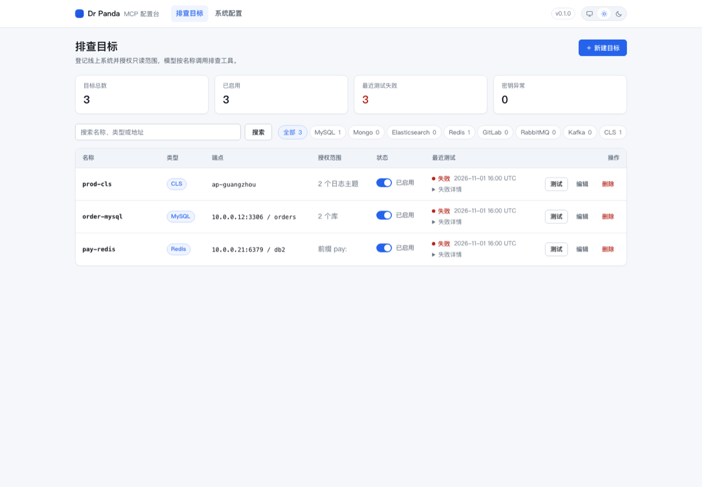

# Dr Panda MCP

面向线上故障排查的**只读 MCP 服务**。

在网页里登记 MySQL、MongoDB、Elasticsearch、Redis、GitLab、RabbitMQ、Kafka、CLS 的地址、凭证和允许访问的范围；Cursor、Codex、DeepSeek Harness 等 MCP 客户端通过 Streamable HTTP 调用 `/mcp`，模型只能按 `target` 名称使用只读工具。

**模型不能自行传入主机、账号或密码。**



---

## 为什么用它

线上排障时，模型经常需要同时看日志、代码、数据库、缓存和消息堆积。直接把生产凭证交给模型风险太高；只读代理、临时截图、人工代查又难以复现和审计。

Dr Panda MCP 把“能查什么”提前收敛成三类边界：

1. **连接边界**：只允许访问网页里登记过的 target；
2. **操作边界**：只执行只读白名单，管理命令与高开销查询在连接前拒绝；
3. **身份边界**：网页登录和 MCP Bearer Token 独立，所有调用记录到真实管理员。

---

## 当前状态

M0–M7 已落地并通过测试：

| 阶段 | 内容 | 状态 |
|---|---|---|
| M0–M2 | 工程地基、配置库、密钥加密、八类只读闸门 | 完成 |
| M3 | 配置台网页、MCP `/mcp` 接入 | 完成 |
| M4 | CLS 日志、GitLab 代码（5 个工具） | 完成 |
| M5 | MySQL / Mongo / ES / Redis（17 个工具） | 完成 |
| M6 | RabbitMQ / Kafka（5 个工具） | 完成 |
| M7 | 首次安装、登录、多 Token、审计到人 | 完成 |

- 工具总数：**28**
- 当前测试：**442 passed**，`ruff check .` 通过
- 默认监听：`127.0.0.1:8111`
- 首次安装支持 SQLite / MySQL / PostgreSQL 配置库
- 前端采用服务端渲染；核心流程无 JS 可用，局部 JS 仅做渐进增强

真实联调覆盖：

- MySQL / MongoDB / Elasticsearch / Redis / RabbitMQ 已用 Docker 真实上游验证；
- MySQL TLS/mTLS、target 级 CA、ES 多 host failover、Mongo 多种认证方式已覆盖；
- Kafka、CLS、GitLab 工具代码和单测已完成，但**尚未用真实上游做端到端验收**。

---

## 快速开始

### 环境

- Python `>= 3.11`
- [uv](https://docs.astral.sh/uv/)
- 首次启动默认使用 SQLite，无需额外数据库

```bash
git clone <repo-url>
cd dr-panda-mcp
uv sync
uv run dr-panda-mcp
```

浏览器打开：

```text
http://127.0.0.1:8111/
```

首次进入安装向导：

1. 设置管理员密码（至少 8 位）；
2. 选择配置库：SQLite（推荐本地使用）/ MySQL / PostgreSQL；
3. 测试连接；
4. 完成安装，保存安装完成页显示的 MCP Token。

健康检查：

```bash
curl -fsS http://127.0.0.1:8111/healthz
# {"ok":true,"version":"0.1.0","db":"ok"}
```

### 配置库额外依赖

```bash
uv sync --extra mysql       # MySQL 配置库：asyncmy
uv sync --extra postgres    # PostgreSQL 配置库：asyncpg
uv sync --all-extras        # 同时安装排查组件可选依赖
```

排查组件 extras：

```bash
uv sync --extra mongo
uv sync --extra redis
uv sync --extra kafka
uv sync --extra cls
```

GitLab 使用 `httpx`，不需要额外 extra；RabbitMQ 使用 HTTP 管理接口。

---

## 首次安装会生成哪些文件

安装完成后会在 `data/` 下生成：

| 文件 | 作用 | 丢失后果 |
|---|---|---|
| `install.json` | 记录配置库 URL（加密） | 需恢复备份，否则无法自动找到配置库 |
| `install.key` | 解密 `install.json` | 无法恢复安装状态 |
| `session.key` | 网页 Session 签名密钥 | 所有网页 Session 失效，可重新登录 |
| `secret.key` | 加密 target 密钥 | 已登记密钥不可恢复 |
| `dr-panda.sqlite` | 默认 SQLite 配置库 | 丢失目标、审计和配置 |

- 安装状态文件权限为 `0600`；
- **备份配置库时必须同时备份 `secret.key`、`install.json`、`install.key`、`session.key`**；
- 不要把 `data/` 提交到 Git。

---

## 客户端接入

在所有客户端中配置 MCP URL 和 Bearer Token：

```json
{
  "mcpServers": {
    "drpanda": {
      "url": "http://127.0.0.1:8111/mcp",
      "headers": {
        "Authorization": "Bearer <在“我的”页面创建的 MCP Token>"
      }
    }
  }
}
```

### Cursor

把上面的 `mcpServers` 配置写入 Cursor 的 MCP 配置文件。

### Codex

```toml
[mcp_servers.drpanda]
url = "http://127.0.0.1:8111/mcp"

[mcp_servers.drpanda.headers]
Authorization = "Bearer <token>"
```

### DeepSeek Harness

`serverName` 使用 `drpanda`，模型侧工具名形如：

```text
mcp__drpanda__mysql_query
mcp__drpanda__cls_search
mcp__drpanda__systems_status
```

说明：

- `/mcp` 未携带有效 Bearer Token 时返回 `401`；
- 网页登录 Session **不能**代替 MCP Token；
- Token 只存哈希，完整值只在创建时显示一次；丢失只能删除后重新生成；
- 修改端口后，客户端 URL 要同步修改。

---

## 登记目标与工具

网页里每个目标登记一次，工具调用时只传 `target` 名称。

| 类型 | 工具 |
|---|---|
| `mysql` | `mysql_tables`、`mysql_describe`、`mysql_query`、`mysql_explain`、`mysql_processlist` |
| `mongo` | `mongo_collections`、`mongo_find`、`mongo_aggregate`、`mongo_stats` |
| `elasticsearch` | `es_mapping`、`es_search`、`es_health`、`es_index_stats` |
| `redis` | `redis_get`、`redis_scan`、`redis_info`、`redis_slowlog` |
| `gitlab` | `gitlab_search_code`、`gitlab_get_file`、`gitlab_blame` |
| `cls` | `cls_search`、`cls_context` |
| `rabbitmq` | `rabbit_queues`、`rabbit_queue` |
| `kafka` | `kafka_lag`、`kafka_offsets`、`kafka_peek` |
| 全局 | `systems_status` |

另有 `investigate_error` prompt，用于从错误现象开始组织排查路径。

目标范围只能缩小可读边界：

- MySQL：库 / 表；
- MongoDB：库 / 集合；
- Elasticsearch：索引；
- Redis：key 前缀 / 命令范围；
- GitLab：项目 / 分支；
- RabbitMQ：vhost / queue；
- Kafka：topic / partition；
- CLS：日志主题与时间范围。

目标名称只允许小写字母、数字和连字符，创建后不可修改。密钥只存密文，列表不回显。

---

## 安全模型

### 绝对只读

- 八类组件的所有工具（包括网页“测试连接”）只读；
- 账号即使有写权限也不会被使用；
- 只读白名单之外还有绝对危险规则：
  - 管理/变更类命令；
  - 无界扫描、大聚合、深度分页、脚本执行等；
- 危险判定在建立连接之前完成，拒绝码 `DANGEROUS_OPERATION`；
- 每次调用受超时、行数、字节和每 target 并发上限约束，截断会明确标记。

### 认证与请求保护

- 网页登录：管理员密码 + HMAC 签名 Session Cookie；
- 表单：CSRF 双提交校验；
- `/mcp`：独立 Bearer Token，只存 SHA-256 哈希；
- Host/Origin 校验：拒绝异常 Origin；
- 非 loopback 监听必须显式设置 `DR_PANDA_ALLOW_REMOTE=1` 和 HTTPS `DR_PANDA_PUBLIC_URL`；
- 配置库变更写审计，审计 actor 为真实管理员。

### 前端

- Jinja2 服务端渲染；
- 核心流程无 JS 可用；
- 仅使用自托管、无依赖的小脚本：
  - `app.js`：原生 `<dialog>`、表单加载态；
  - `copy-token.js`：复制 Token；
- 不引入前端框架、Node 构建链、第三方 CDN；
- 无 JS 时提供独立表单/确认页或手动复制提示，不显示假按钮。

详见 [frontend-js-policy.md](docs/verify/frontend-js-policy.md)。

---

## 系统配置

登录后进入 `/settings` 修改。配置存在配置库中，带范围校验，修改即写审计和 `settings_history`。

| 配置键 | 默认 | 范围 | 说明 |
|---|---:|---:|---|
| `default_target_timeout_s` | 15 秒 | 1–120 | 新建目标默认超时 |
| `default_target_max_rows` | 100 行 | 1–1000 | 新建目标默认行数 |
| `default_target_max_bytes` | 102400 字节 | 4096–1048576 | 新建目标默认字节上限 |
| `target_max_concurrency` | 10 | 1–50 | 每 target 并发上限 |
| `audit_retention_days` | 90 天 | 1–3650 | 审计保留期 |
| `audit_cleanup_interval_minutes` | 60 | 5–1440 | 审计清理间隔 |
| `catalog_max_clients` | 32 | 4–128 | 进程内连接器缓存上限 |
| `session_ttl_minutes` | 720 | 5–10080 | 网页 Session 有效期 |
| `backup_keep_count` | 20 | 1–20 | SQLite 迁移前备份保留数量 |

系统配置只能调整运行策略，**不能放宽只读规则、危险规则、密钥管理或目标范围**。

---

## 环境变量

| 变量 | 默认值 | 说明 |
|---|---|---|
| `DR_PANDA_HOST` | `127.0.0.1` | 监听地址 |
| `DR_PANDA_PORT` | `8111` | 网页与 `/mcp` 共用端口 |
| `DR_PANDA_DATABASE_URL` | `sqlite:///data/dr-panda.sqlite` | 配置库 URL；安装完成后以 `install.json` 为准 |
| `DR_PANDA_SECRET_KEY` | 未设置 | base64 编码的 32 字节密钥；未设置时使用 `data/secret.key` |
| `DR_PANDA_LOG_LEVEL` | `INFO` | 日志级别 |
| `DR_PANDA_ALLOW_REMOTE` | 未设置 | 显式允许非 loopback 监听 |
| `DR_PANDA_PUBLIC_URL` | 未设置 | 远程访问的 HTTPS 公开地址 |

远程部署建议：

- 使用 HTTPS 反向代理，并设置 `DR_PANDA_PUBLIC_URL`；
- 不要直接暴露 `8111` 到公网；
- 先在本机完成安装，再切换远程监听；
- 反向代理的真实 TLS 环境仍需自行验收。

---

## 运维

### 管理员密码重置

本地执行：

```bash
uv run dr-panda-mcp-admin reset-password
```

重置后会递增 `auth_version`，所有现有网页 Session 失效；MCP Token 不受影响。

### SQLite 备份

- 仅在存在 pending Alembic migration 时自动备份；
- 备份写入 `data/backup/`；
- 保留数量由 `backup_keep_count` 控制；
- 手动备份请同时复制配置库和四个密钥/安装文件。

### 审计

- 每次工具调用、目标变更、配置变更都写入 `audit`；
- 审计清理默认 90 天保留，每小时检查一轮；
- 清理只记日志，不写审计，避免自增。

---

## 开发与测试

```bash
uv sync --all-extras
uv run pytest -q
uv run ruff check .
uv run python scripts/smoke.py
```

- 测试使用临时 SQLite 和临时密钥，不连接真实线上系统；
- Docker 联调脚本在 `scripts/integration/`；
- 当前全量：**442 passed**。

### 项目结构

```text
src/dr_panda_mcp/
  __init__.py         启动入口
  config.py           环境变量与配置
  setup.py            首次安装向导
  admin.py            管理员本地维护命令
  auth.py             密码、Session、CSRF、MCP Token
  server.py           FastMCP、/mcp 与网页装配
  runtime.py          引擎、迁移、密钥、ConfigStore
  settings.py         系统配置默认值/范围/分组
  connectors/         八类上游连接器
  guards/             只读白名单与危险命令规则
  tools/              MCP 工具实现与审计
  prompts.py          investigate_error
  web/                routes/templates/static/渲染
  store/              SQLAlchemy 模型、仓储、Alembic 迁移
tests/                单元、契约、网页、工具与迁移测试
docs/                 规划、里程碑、UI 规范与验证记录
scripts/              冒烟与 Docker 联调脚本
```

---

## 已验证与未验证

### 已验证

- SQLite / MySQL / PostgreSQL 配置库安装；
- 多 MCP Token 创建、复制、删除、分页；
- 登录、Session、CSRF、登出与密码修改；
- 目标增删改、启停、测试连接、密钥加密；
- 系统配置保存、逐项/全局恢复默认、历史记录；
- 明暗主题、中英文、1440/390 响应式布局；
- MySQL / Mongo / ES / Redis / RabbitMQ Docker 真实上游；
- 只读闸门、危险命令拒绝、超时/行数/字节限制。

### 未验证 / 边界

- Kafka 真实上游端到端（镜像不可用）；
- CLS、GitLab 真实凭证端到端；
- 反向代理后的真实 HTTPS/TLS 验收；
- 多用户、RBAC、OAuth/OIDC、MFA；
- 密码找回页面（仅提供本地 CLI 重置）；
- `install.json` / `install.key` / `secret.key` 丢失后的自动恢复。

未验证能力不会因为其他组件通过就视为可用。

---

## 文档

- [docs/planning.md](docs/planning.md)：方案、接口、数据模型、只读/危险规则
- [docs/milestones.md](docs/milestones.md)：里程碑与验收口径
- [docs/ui-design.md](docs/ui-design.md)：配置台设计系统与页面规格
- [docs/verify/m7-01.md](docs/verify/m7-01.md)：M7 安装、登录、多 Token
- [docs/verify/frontend-js-policy.md](docs/verify/frontend-js-policy.md)：前端 JS 渐进增强约束
- [docs/verify/ux-audit-01.md](docs/verify/ux-audit-01.md)：全站交互审计与修复
- [docs/verify/settings-03.md](docs/verify/settings-03.md)：系统配置结构化
- [docs/verify/](docs/verify/)：全部里程碑、集成与硬化验证记录
