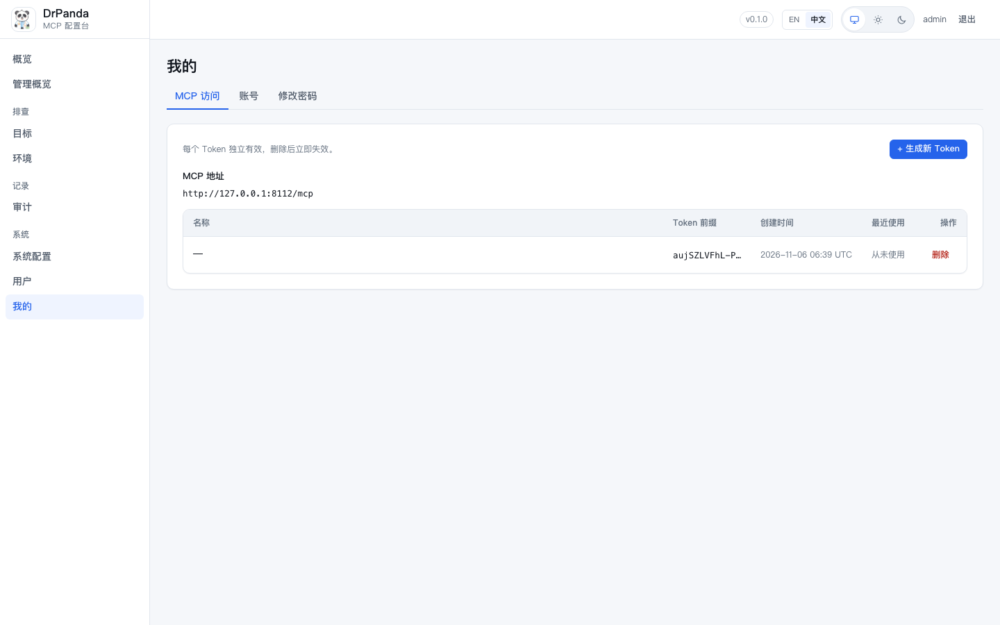
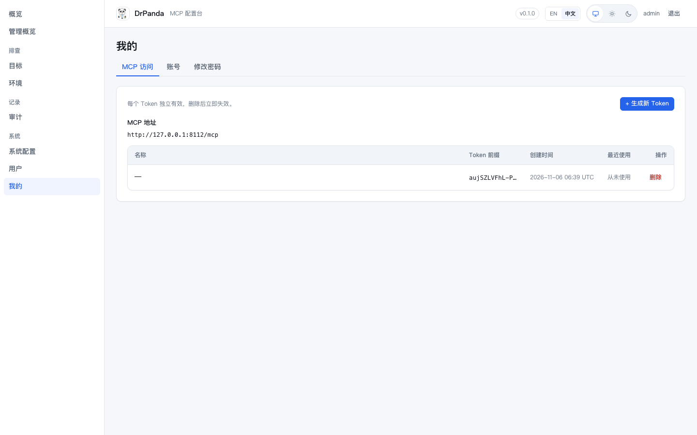

# 品牌区视觉方案对比 01（静态视觉稿）

用真实页面 HTML（`我的` 页）+ 项目实际 `app.css` 渲染，只叠加方案 CSS，不改项目代码；中文、1440×900、浅色主题。

## 方案 A：精细化侧栏品牌

- 侧栏品牌保持两行文字；图标改为 36px 圆角容器（浅底 + 描边 + 内边距），标题 16px、副标题 11.5px，显式 2px 行距；
- 品牌块与导航都从 16px 左边距开始，导航上方增加呼吸间距。

优点：改动最小，保留当前信息结构；缺点：仍受 216px 侧栏限制，品牌区不算特别出彩。

## 方案 B：品牌上移到顶栏

- 桌面端顶栏左侧显示 logo + DrPanda + MCP 配置台；侧栏去掉品牌，直接从导航开始；
- 右侧仍是版本/语言/主题/用户控件。

优点：品牌不受侧栏宽度限制，导航顶对齐，整体更像标准后台；缺点：需调整桌面 grid/断点，所有桌面截图与响应式要重新验收。

## 方案 C：侧栏品牌简化成单行

- 保留侧栏品牌，但去掉「MCP 配置台」副标题，只留 32px 图标 + DrPanda 一行；导航紧跟其后。

优点：信息更克制、侧栏更干净；缺点：副标题承载的产品定位消失，需要另找位置（顶栏/关于页）。

## 建议

- 优先 A（风险最低、保留现状信息）；若觉得品牌区仍局促，选 B（结构最优）；C 适合"侧栏极简"的偏好。
- 真正落地时 A 只需要 CSS + 也许一张方形 logo 派生资源；B 需要模板/布局调整；C 只需 CSS 与文案位置调整。

---

**落地结果**：已按方案 A 实施，实际截图见 [brand-option-a-real-1440.png](assets/ui/brand-option-a-real-1440.png)。
