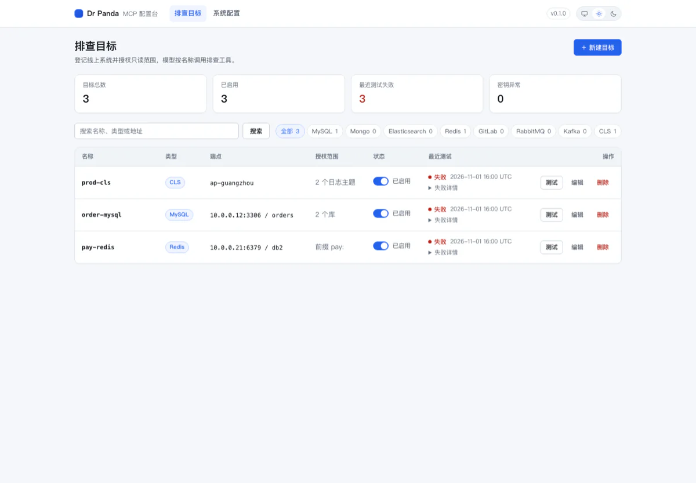
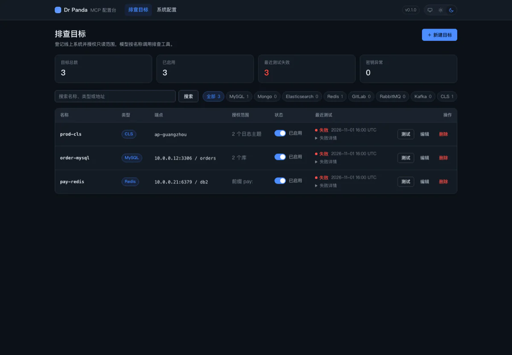
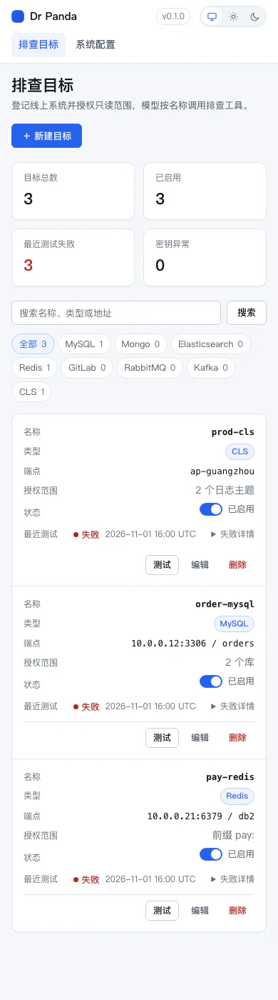
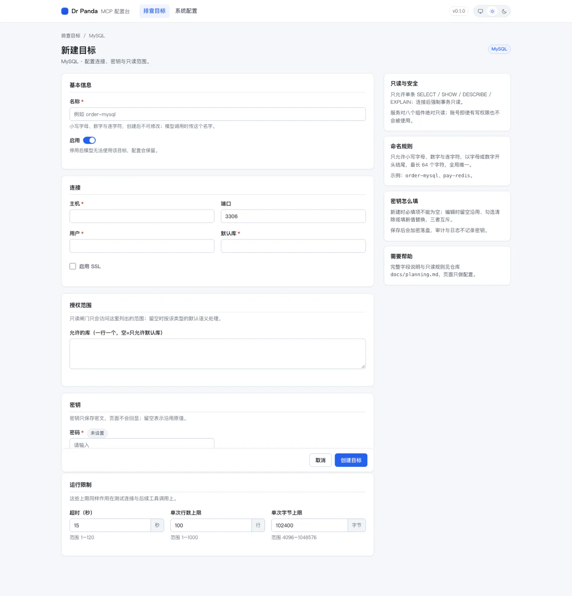
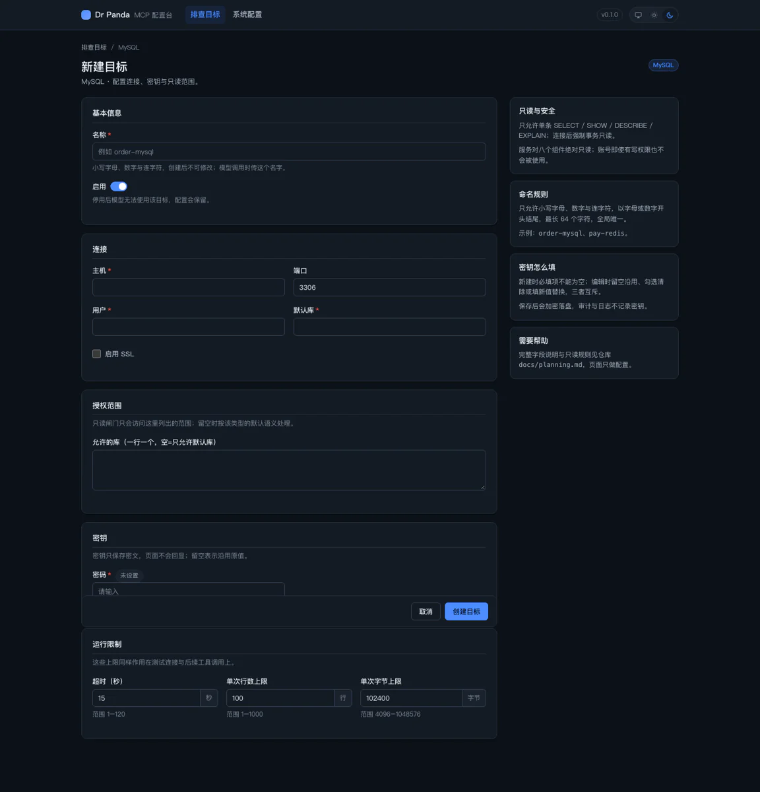
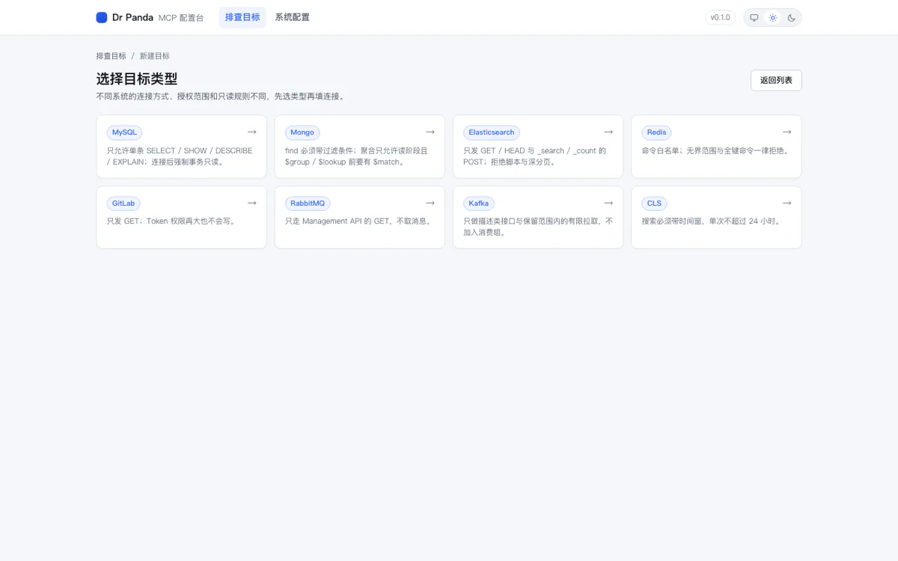
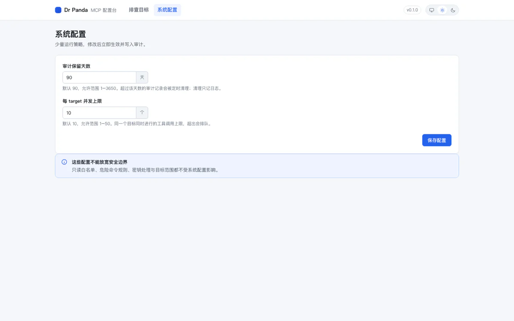
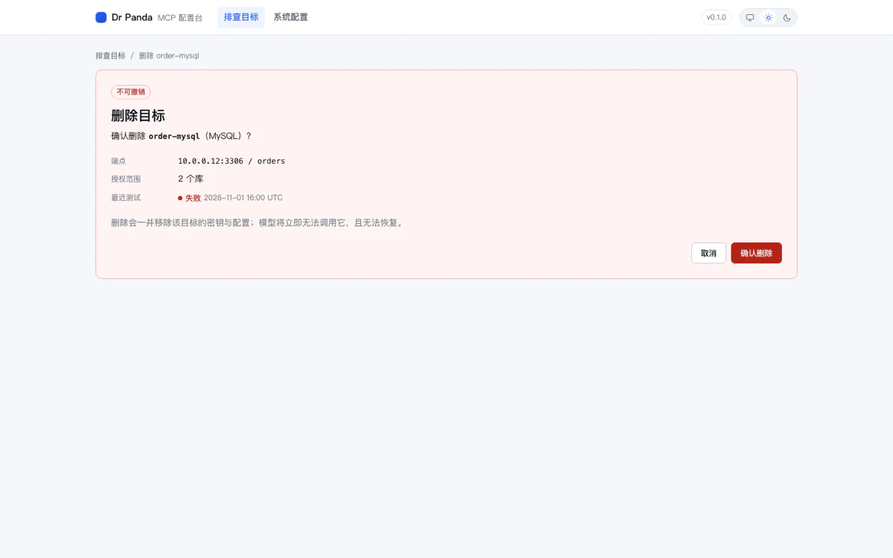

# M3.5 配置台视觉与主题重构 · 验证记录

依据 [docs/milestones.md](../milestones.md) 的 M3.5 检查点；设计规格见 [docs/ui-design.md](../ui-design.md)。本记录不含排期信息。

**环境**：macOS（Apple Silicon）、Chrome 156 headless（DevTools 协议）、Python 3.11。截图存于 `docs/zh-CN/verify/assets/ui/`。

## 验证结果

| 编号 | 验证项 | 方法 | 结果 |
|---|---|---|---|
| VU1 | 主题跟随与切换 | 无 Cookie 访问；`POST /theme` 依次切 deep/light/system；读取 `data-theme` | 通过；无 Cookie 时 `<html>` 无 `data-theme` 并跟随 `prefers-color-scheme`；手选后刷新保持；system 清除 Cookie；无闪烁（服务端渲染） |
| VU2 | 两套主题对比度 | `pytest tests/test_ui_contrast.py` 解析 CSS token 计算对比度 | 通过；正文/次级/语义色与按钮对比度均 ≥4.5:1，浅深两套 |
| VU3 | 三宽度无溢出 | Chrome DevTools 协议读取 `scrollWidth == innerWidth`；1440/390 | 通过；两宽度均无横向溢出；≤900px 表格转卡片 |
| VU4 | 键盘与读屏语义 | CDP 连续 Tab 记录 `activeElement` 与焦点轮廓；检查 aria | 通过；首个焦点为"跳到主要内容"；顺序为 品牌→导航→主题→新建→搜索→…；焦点环 `solid 2px`；页面含 `aria-current/aria-pressed/aria-invalid/scope/aria-label` |
| VU5 | 零 JS 与无外部资源 | 断言页面无 `<script>`；CSS 无 `@import`/外部 URL；`tests/test_web.py` | 通过；主题切换、测试连接、删除等全部为普通表单 POST；无外部字体/CDN |
| VU6 | 视觉基线 | 浅/深 × 桌面/移动、类型选择、表单、设置、删除截图 | 通过；见下方截图；无重叠/截断，状态徽标可辨 |
| VU7 | 回归 | `pytest -q` + `scripts/smoke.py` | 通过；**316 passed**；冒烟 healthz + MCP `systems_status` 正常 |
| VU8 | 文档同步 | 人工核对 | 通过；planning v0.8、`docs/ui-design.md`、README、milestones、本记录 |

## 视觉基线

浅色列表（1440）：



深色列表（1440）：



窄屏列表（390，表格转卡片）：



新建表单（浅色 / 深色）：





类型选择、系统配置、删除确认：







## 证据摘要

- 主题：`POST /theme` 返回 303 + `Set-Cookie: drpanda_theme=...; Path=/; HttpOnly; SameSite=Lax`；`next` 为 `//evil.example` 时回退 `/`；无 Cookie 时 HTML 不含 `data-theme`。
- 无 JS：页面源码不含 `<script>`；主题切换是三个提交按钮，删除/测试/启停/保存全部为 `<form method="post">`。
- 对比度（自动）：正文 16.75/16.07、次级 7.11/8.23、按钮 5.17/5.86、danger 6.05/5.13（浅/深）。
- 无溢出：CDP `{"sw":390,"iw":390,"overflow":[]}`、`{"sw":1440,"iw":1440,"overflow":[]}`。
- 键盘：首个焦点 `skip-link`；焦点轮廓 `solid 2px`；页面顶部导航 `aria-current="page"`，主题按钮 `aria-pressed`。
- 静态资源：`/static/app.css` 200 + `ETag`；带 `If-None-Match` 返回 304；CSS 27.8KB（预算 <30KB）；无外部请求。
- 全量测试：316 passed；`ruff check` 全过；冒烟 `{'ok': True, 'version': '0.1.0', 'db': 'ok'}` + MCP 工具调用正常。

## 本里程碑产生的文件

```
src/dr_panda_mcp/web/static/app.css        设计 token 与组件样式（浅/深）
src/dr_panda_mcp/web/theme.py              Cookie 三态主题与站内跳转校验
src/dr_panda_mcp/web/assets.py             CSS 读取、ETag 与缓存
src/dr_panda_mcp/web/render.py             注入主题/导航/版本/flash
src/dr_panda_mcp/web/routes.py             /theme、/static、搜索筛选、类型选择、flash、HTML 错误页
src/dr_panda_mcp/web/views.py              端点/范围摘要、统计、筛选
src/dr_panda_mcp/web/forms.py              类型卡片、字段单位
src/dr_panda_mcp/web/templates/*           base/_macros/_flash 式提示条、index/form/targets_new/settings/delete/error
tests/test_web.py                          主题、静态资源、搜索筛选、flash、错误页、a11y 断言
tests/test_ui_contrast.py                  两套 token 对比度与主题机制
docs/ui-design.md                          设计系统与页面规格
docs/zh-CN/verify/assets/ui/                     视觉基线截图
```

同时更新：`docs/planning.md`（v0.8：4.1 路由、4.4 页面风格与交互）、`docs/milestones.md`（M3.5 完成）、`README.md`。

## 未验证项

- **真实浏览器矩阵**：只在 Chrome 156 验证；Safari / Firefox 的 `color-scheme`、`prefers-color-scheme` 行为需人工抽查，未纳入自动化。
- **读屏软件**：只验证了语义属性与焦点顺序，未用 VoiceOver / NVDA 实际朗读。
- **触摸设备**：390px 视口验证了布局，未在真机触控上验证点击目标尺寸。
